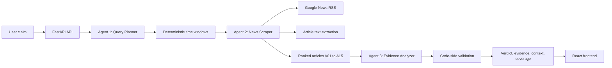

# VeriScan AI: Project Explanation and Presentation Guide

**Project:** Fake News Risk Analyzer and Multi-Agent Fact Verifier  
**Application name:** VeriScan AI  
**Project type:** Full-stack AI-assisted news claim verification system  
**Primary focus:** Indian news claims, including current, historical, and recurring-event claims  
**Last updated:** 2026-10-06

This is the single project document. It is written so that an AI, presenter, or evaluator can explain the project from the problem statement through the implementation, results, limitations, and code locations.

## 1. One-minute explanation

VeriScan AI is a web application that accepts a news headline, article text, or factual claim and checks it against retrieved news evidence. It does not ask one language model to invent a true/false answer from memory. Instead, it separates the work into three roles:

1. **Query Planner:** understands the claim and creates neutral search queries.
2. **News Scraper:** retrieves and ranks real articles from date-bounded Google News RSS searches. This stage is ordinary Python code and does not judge the claim.
3. **Evidence Analyzer:** examines only the retrieved articles and produces structured assessments.

After the model responds, deterministic Python code checks article IDs, evidence quotes, relevance, verdict consistency, confidence, dates, and retrieval completeness. The final result contains a verdict, confidence, explanation, supporting or contradicting evidence, contextual articles, coverage information, and limitations.

The main design principle is **LLMs assist with language and reasoning, while code controls evidence, dates, safety, and admissibility of the final answer**.

## 2. Problem being solved

News verification is difficult for four reasons:

- A language model can use its internal memory instead of current evidence and hallucinate a plausible answer.
- Search systems favor recent pages, so a historical claim can be judged using the wrong time period.
- A recurring claim can be true for an old edition but false or unverified when presented as a current event.
- An article can mention the same person or organization while discussing a completely different event.

A simple prompt such as `Is this news true?` does not solve these problems. It also makes it difficult to show why a result was produced or to detect fabricated citations.

### Project objective

Given a claim, produce an explainable and grounded result that:

- searches the appropriate time period;
- separates direct evidence from historical or contextual information;
- never treats absence of search results as proof of falsity;
- cites only retrieved articles with stable IDs;
- exposes uncertainty and incomplete retrieval;
- returns an explicit error instead of an invented verdict when an essential service fails.

## 3. What the system accepts and returns

### Input

The user can provide:

- a headline;
- article text;
- a short factual claim; or
- a combination of headline and text.

The backend normalizes the supplied text into one claim before planning searches.

### Output

The API returns schema version `2.0` and includes:

- `verdict`: `True`, `False`, `Partially True`, `Misleading`, `Unverified`, or `Not Checkable`;
- `confidence`: `High`, `Medium`, or `Low`;
- `summary` and, where appropriate, a correction;
- `evidence_articles`: direct articles that support or contradict the primary reading;
- `context_articles`: historical, neutral, or contextual articles;
- `coverage`: queries, date windows, article counts, source counts, and failures;
- `error`: a structured error when the pipeline cannot safely complete.

The frontend displays the verdict, confidence, pipeline progress, evidence, sources, context, and limitations.

## 4. System architecture



### Component responsibilities

| Component | Responsibility | What it must not do |
|---|---|---|
| Agent 1: Query Planner | Interpret language, identify entities, propositions, time reference, aliases, and query purposes | Decide whether the claim is true or calculate date operators |
| Date-window module | Convert abstract window roles into exact `after` and `before` dates | Depend on model-written dates |
| Agent 2: News Scraper | Query RSS, retry transient retrieval failures, filter, rank, deduplicate, fetch bounded article text | Decide the final verdict |
| Agent 3: Evidence Analyzer | Assess each supplied article and synthesize a structured answer | Search the web, call tools, or use unsupplied memory as evidence |
| Code-side validator | Validate IDs and quotes, enforce verdict rules, cap confidence, remove irrelevant output | Generate facts that are not grounded in evidence |
| Frontend | Collect claims and present progress and validated results | Perform verification logic |

## 5. End-to-end flow

### Step 1: Normalize the claim

`backend/agents/verifier.py` combines the headline and article text, collapses unnecessary whitespace, and rejects an empty request with an `Unverified` response explaining that a claim is required.

### Step 2: Plan the search

Agent 1 returns a typed `QueryPlan` containing:

- normalized claim;
- language and check-worthiness;
- atomic propositions;
- time reference, such as explicit year or current event;
- event recurrence;
- explicit dates;
- entities and aliases;
- `must_have_terms` concept groups;
- likely confusions;
- query objects with purpose and abstract `window_role`.

The planner is outcome-neutral. For example, it should search for event results, not only search phrases that assume the claim is true.

The planner code also repairs unsafe or low-quality model output:

- removes date and `site:` operators from model-written query text;
- rejects queries outside the allowed token range;
- removes invalid official-source queries without a site hint;
- deduplicates only very similar queries using a high Jaccard threshold;
- guarantees a minimum share of outcome-neutral queries;
- backfills missing queries deterministically.

### Step 3: Derive dates in code

Agent 1 chooses a role, but Python computes the dates. This avoids trusting generated date operators.

Examples:

- Claim with year `2016`: searches a window covering 2016, with padding around the year.
- Claim with date `23 August 2023`: searches around that date.
- Current claim: searches roughly the latest 90 days.
- Undated recurring event: uses a wider recent window and also historical slices.
- Historical role without a specific year: searches configured older slices.

All windows satisfy `after < before`. The local reference date is computed in `Asia/Kolkata`.

### Step 4: Retrieve articles

Agent 2 builds Google News RSS URLs from the cleaned query and code-generated date bounds. It records each query's status as successful, empty, or failed. Timeouts and transient connection failures are retried, and failures are preserved in coverage metadata instead of being silently treated as empty searches.

The scraper:

- limits RSS results per query;
- deduplicates by canonical URL and normalized title;
- assigns source tiers from `backend/config/sources.yaml`;
- calculates concept coverage and lexical relevance;
- applies a publisher-tier prior without treating domain reputation as proof;
- keeps recent and historical retrieval pools from crowding each other out;
- assigns stable article IDs such as `A01`, `A02`, and `A03` after ranking;
- attempts bounded article-text extraction with `trafilatura`;
- falls back to the RSS snippet when full text is unavailable;
- blocks private or loopback addresses to reduce SSRF risk.

### Step 5: Analyze only supplied evidence

If no usable article is found, Agent 3 is not called. The system returns a deterministic `Unverified` result with a clear coverage limitation. This prevents a model from filling an empty evidence set from memory.

If articles exist, Agent 3 receives the claim analysis, coverage data, and a JSON-serialized article list. It has no search tools. The requested structured response assesses articles before producing a verdict, including:

- relevance;
- stance;
- evidence quote;
- event date;
- article kind;
- proposition-level support or contradiction;
- historical context;
- summary and limitations.

Untrusted text is serialized as JSON inside semantic sections. This prevents a title or article body containing text such as `</articles>` from escaping its intended data boundary.

### Step 6: Validate and assemble the result

The analyzer validates the model output and then applies deterministic checks. The verifier maps only validated article IDs back to source records. Irrelevant articles are never sent to the frontend as evidence.

The frontend receives separate evidence and context lists instead of one undifferentiated source list.

## 6. Why this method was selected

### Why use multiple agents instead of one prompt?

A single prompt mixes search, interpretation, evidence selection, and judgment. That makes errors hard to locate and lets the model silently use unsupported knowledge. The three-agent design gives each stage a narrow responsibility and creates inspectable intermediate data.

### Why use an LLM for planning?

Claims are expressed in natural language. An LLM is useful for identifying entities, aliases, propositions, ambiguity, language, and temporal references. These are language-understanding tasks. The model does not get authority over exact dates or the final verdict.

### Why use ordinary code for retrieval and dates?

Dates, URL construction, limits, deduplication, retries, and time windows should be reproducible. Generated dates can be wrong or can silently fall back to the present. Centralizing this logic makes explicit historical claims testable and traceable.

### Why Google News RSS?

Google News RSS gives a practical, lightweight way to search a broad set of publishers without building a crawler for every website. It supports query and date-window parameters and provides publisher metadata. It is not treated as complete or permanently stable; coverage and redirect behavior are recorded as limitations.

### Why not use only a source whitelist?

A credible publisher can still publish an incorrect report, and an unfamiliar source can contain a correct local report. Source tier is therefore a ranking and confidence signal, not a truth oracle. Article relevance, direct evidence, corroboration, and quote grounding remain necessary.

### Why retrieve full article text?

RSS titles and snippets may be too short or ambiguous. Full-text extraction can provide stronger context and a grounded quote. Because paywalls and anti-scraping defenses are common, the system safely falls back to snippets and caps confidence when evidence is limited.

### Why keep historical and recent pools?

Global newest-first sorting can starve historical evidence. An old true event can also be confused with a current recurring claim. Separate pool quotas preserve both recent coverage and historical context.

### Why no web search tool for Agent 3?

Agent 3 must judge the bounded evidence supplied by the application. If it can search independently, it can introduce uncaptured evidence, bypass the retrieval audit, and make the result impossible to reproduce. Retrieval belongs to Agent 2.

### Why deterministic validation after the model?

The model can produce a valid-looking citation to an article it was never given, quote text that does not exist, or say `True` when only one of several propositions is supported. Code can check these conditions cheaply and consistently.

## 7. Verdict and confidence rules

The model proposes an interpretation, but code can downgrade it.

### Verdict meanings

| Verdict | Meaning |
|---|---|
| `True` | All required propositions have direct support and no unresolved direct contradiction is present |
| `False` | A direct article provides a material contradiction to the claim |
| `Partially True` | Some propositions are supported while another detail is contradicted or unsupported |
| `Misleading` | Evidence supports an older event, but the wording presents it as current or otherwise changes its meaning |
| `Unverified` | Evidence is insufficient, retrieval is incomplete, or validation cannot support a definitive verdict |
| `Not Checkable` | The input is opinion, prediction, satire, or lacks a checkable proposition |

The absence of evidence is never automatically converted into `False`.

### Evidence and citation rules

- Article IDs must exist in the supplied article map.
- An irrelevant article cannot support or contradict a claim.
- A supporting or contradicting assessment must provide an evidence quote.
- The quote must be a verbatim normalized substring of the article title or excerpt.
- A fabricated or non-verbatim quote is removed and the stance is downgraded to neutral context.
- Invalid citations lower confidence and can downgrade a definitive verdict to `Unverified`.
- Years and important numeric claims in the summary are checked against cited article text.

### Confidence rules

Confidence is capped by code. High confidence is not allowed when evidence is only from unknown sources, one source, snippets without full text, or incomplete retrieval. Independent source domains and article quality matter more than the model's self-reported confidence.

## 8. Reliability and security design

### LLM error handling

`backend/llm_client.py` classifies failures before retrying:

- **Configuration/client error:** fail fast; retrying another model cannot fix the same invalid request.
- **Quota error:** apply cooldown and move to another configured model when appropriate.
- **Transient error:** retry with bounded backoff, then use a fallback model.
- **Content error:** handle blocked, empty, truncated, or invalid structured output with controlled degradation or one targeted retry.

The configured model capability table controls features such as thinking settings and structured output. Agent 3 requests contain no tools.

### Retrieval safety

- RSS and article requests use timeouts and size limits.
- Article URLs are checked before fetching.
- Private, loopback, and link-local addresses are blocked.
- Extraction failure produces snippet-only evidence rather than an invented article body.

### Prompt-injection resistance

Claims, titles, snippets, and article bodies are untrusted data. They are JSON-serialized and placed in bounded sections. Instructions found inside an article are not treated as system instructions.

### Auditability

Each completed run can be saved to `backend/history_logs/` with planner, scraper, analyzer, verdict, and coverage information. The frontend also receives progress events through the streaming endpoint.

## 9. Results and evaluation

### Deterministic evaluation

The offline harness is `eval/run.py`. It uses mocks and fixtures, so it does not call Gemini or Google News. It covers:

- explicit years, dates, and ranges;
- current and recurring-event windows;
- query deduplication and outcome-neutral backfill;
- `must_have_terms` repair;
- LLM error classification;
- zero-article short-circuiting;
- schema and API response behavior;
- citation and quote grounding;
- verdict consistency and confidence caps;
- prompt-injection containment.

The project documentation records a result of **33/33 deterministic checks passed**. Re-run the command before a presentation to confirm the result in the current environment:

```powershell
python eval/run.py
```

### What this result means

The 33/33 result demonstrates that the deterministic safeguards and regression fixtures pass. It does not mean that every real-world claim is correct or that Google News and Gemini are always available.

### Live behavior

Live verification depends on:

- a valid `GEMINI_API_KEY`;
- model quota and availability;
- internet access;
- Google News indexing;
- publisher accessibility and article dates;
- the quality of the claim and retrieved evidence.

Live evaluation is deliberately opt-in and budgeted:

```powershell
python eval/run.py --live --max-live-calls 3
```

Do not describe live claims as guaranteed ground truth. Describe them as evidence-grounded assessments with explicit coverage and confidence limits.

### Useful case studies for the presentation

1. **Historical explicit-year claim:** a claim containing `2016` should cause the date module to search a window containing 2016, rather than silently searching only the latest 90 days.
2. **Historical event with authoritative coverage:** a claim such as Chandrayaan-3 landing on 23 August 2023 can receive strong support when retrieved articles contain direct, grounded evidence.
3. **Undated recurring event:** an old article about a previous edition should be displayed as context, not used automatically to prove that the latest edition happened.
4. **No articles or failed retrieval:** the application should return `Unverified` with a coverage explanation, not a guessed verdict.

## 10. Limitations and honest interpretation

- Google News RSS is not a complete archive. Niche, regional, or old events may have sparse coverage.
- Google RSS links can be redirects instead of canonical publisher URLs.
- Paywalls and anti-bot systems can prevent full-text extraction.
- RSS publication date is not necessarily the date on which the reported event happened.
- A source tier indicates publisher context; it does not prove an article is true.
- A language model can misunderstand an ambiguous claim even when the code is functioning correctly.
- A result is only as strong as the relevant evidence that was available and retrieved.
- A high-confidence result should be interpreted as strong support from the retrieved evidence, not as a mathematical proof of reality.

The correct response to weak coverage is a transparent `Unverified` result and a limitation, not a forced binary answer.

## 11. Code location map

### Backend

| Path | Purpose |
|---|---|
| `backend/main.py` | FastAPI application entry point |
| `backend/routes/analyze.py` | REST and streaming analysis routes |
| `backend/controllers/analyze_controller.py` | Request orchestration and progress response handling |
| `backend/agents/planner.py` | Agent 1 planning, query validation, deduplication, and backfill |
| `backend/time_windows.py` | Explicit-date parsing and deterministic date-window derivation |
| `backend/agents/scraper.py` | RSS retrieval, retries, filtering, ranking, article extraction, and source tiers |
| `backend/agents/analyzer.py` | Agent 3 parsing, quote grounding, citation checks, verdict validation, and confidence caps |
| `backend/agents/verifier.py` | End-to-end orchestration, zero-article behavior, API response assembly, and history logging |
| `backend/llm_client.py` | Gemini calls, model fallback, cooldowns, and error classification |
| `backend/config/prompts.py` | Agent system instructions and structured prompts |
| `backend/config/settings.py` | Models, limits, timeouts, and source configuration |
| `backend/config/sources.yaml` | Publisher source tiers |
| `backend/schemas/verification.py` | Pydantic schemas for planner and analyzer contracts |
| `backend/services/history.py` | Timestamped execution logs |
| `backend/utils/progress.py` | Progress event helpers |

### Frontend

| Path | Purpose |
|---|---|
| `frontend/src/App.jsx` | Root application composition |
| `frontend/src/pages/Home.jsx` | Main analysis page |
| `frontend/src/components/AnalysisForm.jsx` | Claim input |
| `frontend/src/components/AgentTimeline.jsx` | Live agent progress |
| `frontend/src/components/AnalysisResult.jsx` | Verdict and result presentation |
| `frontend/src/components/InvestigationScope.jsx` | Drill-down queries, publication range, and nested evidence articles |
| `frontend/src/components/SystemGuideModal.jsx` | Verification methodology and architecture modal popup |
| `frontend/src/context/AnalysisContext.jsx` | Analysis state and session persistence |
| `frontend/src/services/analysisApi.js` | Backend API client |

### Evaluation and operations

| Path | Purpose |
|---|---|
| `eval/run.py` | Offline deterministic and optional live evaluation harness |
| `eval/fixtures.jsonl` | Regression fixtures for grounding and verdict behavior |
| `eval/baseline_claims.jsonl` | Baseline claim set |
| `backend/history_logs/` | Saved execution traces |
| `startAll.bat` | Windows launcher for backend and frontend |
| `render.yaml` | Render deployment configuration |

## 12. How to run the project

### Install and configure

```powershell
python -m venv .venv
.\.venv\Scripts\Activate.ps1
pip install -r requirements.txt
```

Set the API key in `.env`:

```text
GEMINI_API_KEY=your_gemini_api_key_here
```

### Start the backend

```powershell
python -m uvicorn backend.main:app --reload --host 127.0.0.1 --port 8000
```

Backend API documentation is available at `http://localhost:8000/docs`.

### Start the frontend

In another terminal:

```powershell
cd frontend
npm install
npm run dev
```

The frontend is normally available at `http://localhost:5173`.

The root `startAll.bat` can also start both services on Windows.

## 13. Presentation walkthrough

### Slide 1: Title and motivation

Introduce VeriScan AI as an explainable fake-news risk analyzer. State that the problem is not only classifying a claim, but verifying it against the correct time period and showing evidence.

### Slide 2: Problems with naive AI fact-checking

Explain hallucinated sources, recency bias, historical/current confusion, prompt injection, and overconfident binary answers.

### Slide 3: Proposed architecture

Show the three agents and emphasize the separation of responsibilities:

`Claim -> Plan -> Retrieve -> Analyze -> Validate -> Explain`

### Slide 4: Agent 1 and time logic

Explain that the model understands the claim and chooses a window role, while Python computes dates. Use a 2016 claim to show why this prevents the latest-news default from hiding historical evidence.

### Slide 5: Agent 2 retrieval

Explain Google News RSS, source tiers, historical/recent pools, ranking, deduplication, stable article IDs, article extraction, retries, and SSRF protection.

### Slide 6: Agent 3 evidence analysis

Explain that the analyzer sees only supplied articles, has no search tools, and must assess each article before giving a verdict.

### Slide 7: Code-side authority

Demonstrate that code checks IDs and quotes, removes irrelevant articles, downgrades unsupported verdicts, caps confidence, and never converts missing coverage into `False`.

### Slide 8: Results

Report the deterministic evaluation result as 33/33 checks passed, then explain what the suite covers. Clearly separate offline invariant results from quota-dependent live verification.

### Slide 9: Demonstration

Use one current claim, one explicit historical claim, and one undated recurring claim. Show the date windows, evidence/context separation, confidence, and limitations.

### Slide 10: Limitations and future work

Mention sparse historical indexing, paywalls, RSS redirects, quota, and ambiguity. Possible future work includes more archival sources, canonical URL resolution, multilingual improvements, and broader benchmark datasets.

## 14. Short answers to likely questions

**Is this a normal machine-learning classifier?**  
No. The project is an evidence-grounded multi-agent verification pipeline. It uses language models for planning and evidence interpretation, while deterministic code controls important safety and consistency rules.

**Can it guarantee that a claim is true?**  
No. It reports the strength and limitations of the retrieved evidence. `Unverified` is an intentional and important outcome.

**Why is `Unverified` better than guessing?**  
Because no retrieved evidence, incomplete retrieval, or invalid citations cannot logically establish truth or falsity.

**Why not let Gemini search the web itself?**  
That would bypass the retrieval audit and allow the evidence set to change inside the reasoning step. Agent 2 performs retrieval, and Agent 3 judges only the supplied articles.

**Why are older articles sometimes shown?**  
They may explain the historical origin of a recurring claim, but code separates them as context and prevents them from automatically proving a current claim.

**What happens when Gemini is unavailable?**  
The client classifies the failure, retries only where appropriate, uses configured fallbacks, and ultimately returns an explicit error state rather than inventing a verdict.

**What is the strongest technical contribution?**  
The strongest contribution is the combination of temporal retrieval, strict evidence isolation, and code-side authority. The model is useful, but it is not the only defense.

## 15. Final conclusion

VeriScan AI treats fake-news verification as a controlled evidence pipeline rather than a single generative answer. Its main contribution is the disciplined boundary between probabilistic language-model work and deterministic software checks. This boundary improves historical handling, reduces fabricated evidence, exposes retrieval limitations, and makes the result easier to explain during a presentation or audit.